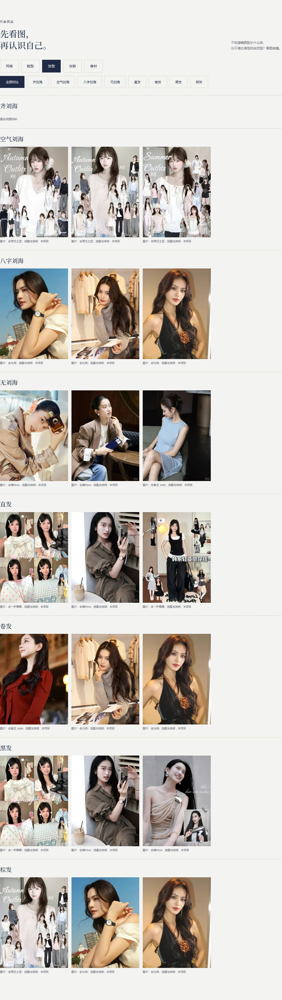
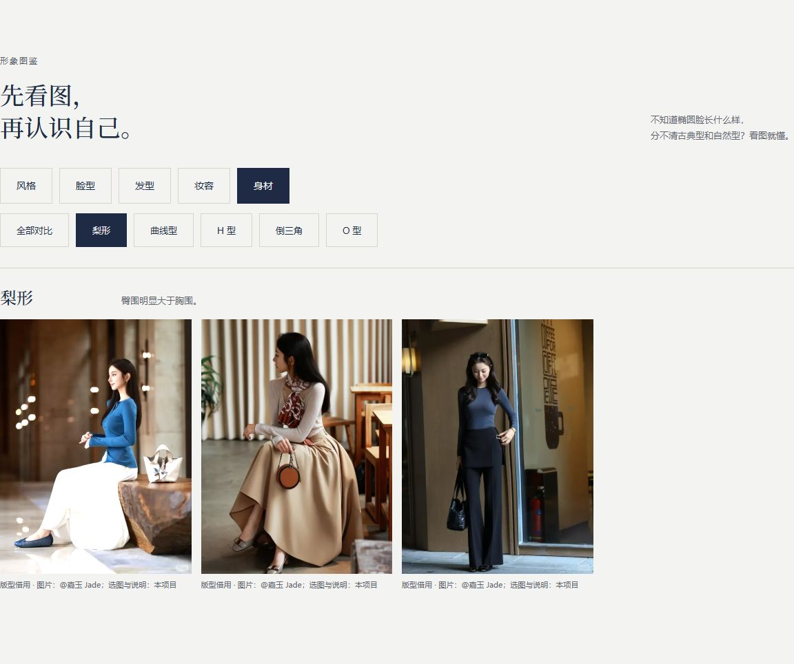

# D 第一批交接与验证

日期：2026-11-07；关联 Issue #4；状态：第一批可审阅，尚未满足全部素材数量。

## 已完成

- 发型 21 条、妆容 16 条、身材版型 15 条，共 52 条记录，复用 35 张现有照片。
- 每条包含分类、说明、原帖地址和署名；妆容区分约 5 / 15 分钟项目练习。
- 图库及报告的博主称谓改为中性表达。
- 选择“不化妆”时，报告不插入妆容图鉴；0 元预算路径保留。

## 验证结果

- 三个修改脚本通过 JavaScript 语法检查，差异格式检查通过。
- 1280 / 375 宽度下，发型、妆容、身材页均无横向滚动、无本地坏图。
- 图片弹窗打开关闭、来源链接存在性检查通过；未逐条验证外站原帖可访问性。
- 实际走完五步测试生成报告；8 种风格均能生成对应报告和两条妆容参考。
- 不化妆、0 元预算、刷新保留、清空答案与报告均通过。
- 最终浏览器运行未记录脚本错误或资源失败。详细结果见 [D-validation.json](D-validation.json)。

## 尚缺材料

- 齐刘海 3 张清晰且获授权照片。
- 10 位新授权博主：古典、戏剧各 2 位，其余六种各 1 位。
- 前卫妆当前为日常转译，完整几何妆近照待补。
- 身材图是版型借用示例，不断言模特身材；如需直接展示身体分类，需参与者同意及相应素材。
- 未提供的付费报告未研究，未新增课程观看记录。

来源与逐条说明见 [D-图鉴来源与缺口.md](D-图鉴来源与缺口.md)。来源、授权范围与上线决定需负责人按仓库规则复核。

## 页面截图

### 发型，电脑宽度

### 妆容，手机宽度

### 身材版型，电脑宽度

